# Jarkom-Modul-5-2026-K-56

| No  | Nama                           | NRP        | Pengerjaan |
| --- | ------------------------------ | ---------- | ---------- |
| 1   | Sahira Bilqis Rivadito         | 5027251037 | 1 - 10     |
| 2   | Muhammmad Ridwan               | 5027251113 | 11 - 20    |

## LAPORAN RESMI MODUL 5


---

# SOAL 11 | Casper Harus Jadi Hantu

Kelompok: K56 | Prefix IP: `192.239.x.x`

> Casper harus jadi hantu: Casper adalah MAGI paling rahasia. Kalau SEELE tahu ia masih hidup, mereka tahu ke mana harus menyerang. Tidak ada perangkat lain yang boleh mem-ping Casper, termasuk yang satu switch. Casper sendiri tetap boleh mem-ping siapa saja. Layanan TCP 5000 Casper tetap hidup. Buktikan ping ke Casper dari Balthasar dan Lilith gagal, sedangkan ping dari Casper ke keduanya berhasil.

## 1. Tujuan

Menerapkan dan memverifikasi penyaringan paket (*host-based firewall*) pada chain `INPUT` di `Magi-Casper`:

* Memblokir seluruh paket `ICMP Echo Request` (`ping` masuk) yang ditujukan ke IP `Magi-Casper` (`192.239.4.58`), termasuk dari perangkat yang berada dalam satu *switch* (`Switch-Terminal`).

* Mengizinkan paket balasan dari koneksi maupun `ping` yang diinisiasi oleh `Magi-Casper` keluar melalui pencocokan state `ESTABLISHED,RELATED`.

* Menjaga layanan **TCP port `5000`** pada `Magi-Casper` tetap aktif dan dapat diakses oleh node lain.

* Membuktikan bahwa `ping` dari `Magi-Balthasar` dan `Lilith` ke `Magi-Casper` gagal, sedangkan `ping` dari `Magi-Casper` ke keduanya berhasil serta layanan TCP `5000` tetap berjalan.

## 2. Rancangan Alamat & Kebijakan Firewall

### Pemetaan Node & Layanan Terkait

| Node | Peran | Subnet | IP Address | Gateway / Layanan | 
| ----- | ----- | ----- | ----- | ----- | 
| **Magi-Casper** | Target Proteksi ("Hantu") | `192.239.4.56/29` | `192.239.4.58` | `192.239.4.57` (`Fuyutsuki`) / TCP `5000` | 
| **Magi-Balthasar** | Tetangga Satu Switch (`Switch-Terminal`) | `192.239.4.56/29` | `192.239.4.59` | `192.239.4.57` (`Fuyutsuki`) | 
| **Lilith** | Host Zona Dogma (Beda Subnet) | `192.239.4.72/29` | `192.239.4.74` | `192.239.4.73` (`Toji`) | 

### Urutan Aturan Chain `INPUT` pada `Magi-Casper`

Karena aturan diterapkan langsung pada chain `INPUT` milik `Magi-Casper`, seluruh paket yang mengarah ke `192.239.4.58`—baik dari beda subnet melalui router maupun langsung dalam satu segmen Layer-2 (`Switch-Terminal`)—akan diproses oleh aturan berikut:

| Urutan | Kondisi Pencocokan (`Match`) | Target | Keterangan | 
| ----- | ----- | ----- | ----- | 
| **1** | `-i lo` | `ACCEPT` | Mengizinkan komunikasi internal antarproses melalui interface *loopback*. | 
| **2** | `-m conntrack --ctstate ESTABLISHED,RELATED` | `ACCEPT` | Mengizinkan paket balasan (`ICMP Echo Reply` & balasan sesi TCP) dari trafik yang dimulai oleh `Magi-Casper`. | 
| **3** | `-p icmp --icmp-type echo-request` | `DROP` | Menolak secara diam-diam (*silent drop*) seluruh permintaan `ping` masuk dari perangkat mana pun. | 
| **4** | `-p tcp --dport 5000` | `ACCEPT` | Memastikan layanan pada TCP port `5000` tetap terbuka untuk koneksi masuk. | 

## 3. Konfigurasi

### 3.1 Magi-Casper – `/root/no11.sh`

Pastikan *listener* layanan TCP port `5000` pada `Magi-Casper` (dari `casper.sh`) dalam keadaan aktif, kemudian buat dan jalankan *script* `/root/no11.sh`:

```
#!/bin/sh
set -e

# Modul 5 - Soal Nomor 11
# Node: Magi-Casper (192.239.4.58)

# Pastikan paket iptables terpasang
command -v iptables >/dev/null 2>&1 || (apt-get update -qq && apt-get install -y -qq iptables)

# Reset chain INPUT agar bersih & idempoten
iptables -F INPUT
iptables -P INPUT ACCEPT

# 1. Izinkan loopback & balasan koneksi yang dimulai Casper (termasuk reply ping keluar)
iptables -A INPUT -i lo -j ACCEPT
iptables -A INPUT -m conntrack --ctstate ESTABLISHED,RELATED -j ACCEPT

# 2. Tolak semua ping masuk (ICMP echo-request), termasuk dari satu switch
iptables -A INPUT -p icmp --icmp-type echo-request -j DROP

# 3. Pastikan layanan TCP 5000 tetap terbuka
iptables -A INPUT -p tcp --dport 5000 -j ACCEPT

```

Berikan izin eksekusi dan jalankan *script* pada `Magi-Casper`:

```
chmod +x /root/no11.sh
sh /root/no11.sh

```

## 4. Pembuktian

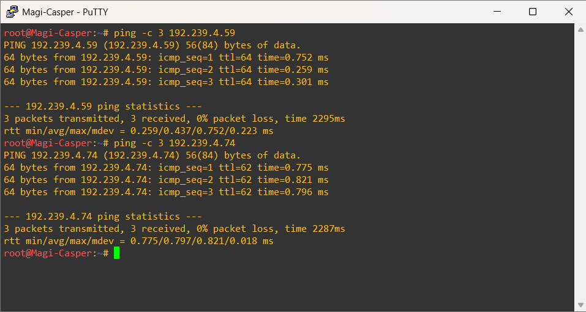
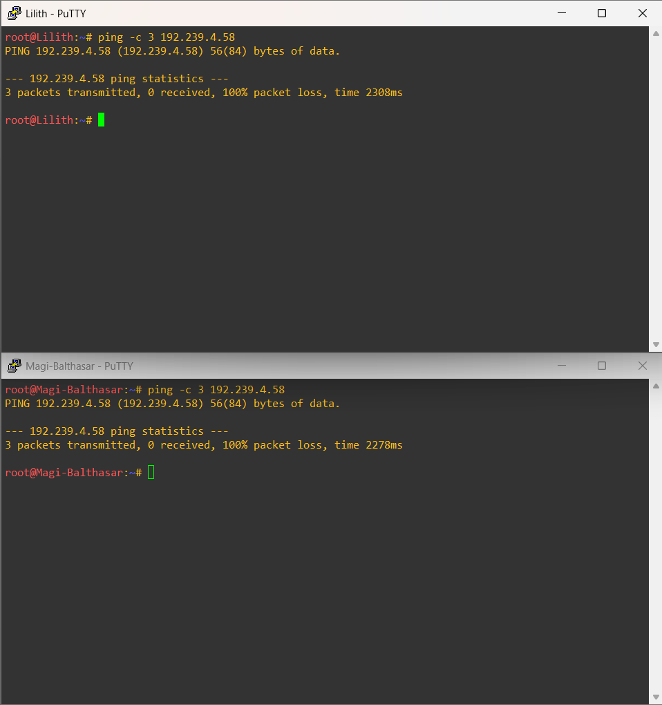

## 5. Kesimpulan

Konfigurasi *host-based firewall* pada chain `INPUT` di `Magi-Casper` berhasil menyembunyikan keberadaan host dari pemindaian `ICMP Echo Request` (`ping`), baik dari host satu *switch* (`Magi-Balthasar`) maupun lintas subnet (`Lilith`). Di saat yang sama, `Magi-Casper` tetap dapat melakukan `ping` keluar berkat pencocokan state `ESTABLISHED,RELATED` serta tetap melayani koneksi masuk pada TCP port `5000`.

## 6. Pemulihan setelah restart

Aturan `iptables` bersifat sementara di memori dan akan hilang apabila container `Magi-Casper` mengalami *restart*. Untuk memulihkan konfigurasi *firewall*, jalankan kembali *script*:

```
sh /root/no11.sh

```

---

# SOAL 12 | Sabotase dan Pemulihan Firewall `Magi-Casper`

Kelompok: K56 | Prefix IP: `192.239.x.x`

> Terjadi sabotase pada sistem pertahanan `Magi-Casper` melalui eksekusi *script* `break_fw.sh` yang menyebabkan gangguan konektivitas keluar maupun layanan internal. Jalankan `break_fw.sh` pada `Magi-Casper`, identifikasi seluruh penyebab kerusakannya, lalu pulihkan kembali fungsi jaringan dan layanan TCP port `5000` dengan tetap mempertahankan kebijakan *hardening* (`INPUT DROP` dan pemblokiran `ping` masuk ke `Magi-Casper`). Buktikan kondisi sebelum dan sesudah perbaikan dilakukan.

## 1. Tujuan

Menganalisis dampak sabotase aturan *firewall* dan memulihkan konektivitas `Magi-Casper` tanpa menurunkan tingkat keamanannya:

* Menjalankan `break_fw.sh` pada `Magi-Casper` (`192.239.4.58`) dan mendiagnosis penyebab kegagalan akses keluar (`ping 8.8.8.8` dan `apt-get update`) serta akses layanan TCP port `5000`.
* Menghapus aturan pemblokiran DNS keluar pada chain `OUTPUT` dan mengizinkan paket balasan koneksi (`ESTABLISHED,RELATED`) pada chain `INPUT`.
* Membuka kembali akses masuk untuk layanan **TCP port `5000`** agar dapat dijangkau oleh `Unit-00` (`192.239.4.68`).
* Tetap mempertahankan kebijakan *default* `INPUT DROP` serta pemblokiran `ICMP Echo Request` (`ping` masuk) dari perangkat lain sesuai ketentuan Soal 11.

## 2. Analisis Kerusakan & Rancangan Kebijakan Firewall

### Pemetaan Node Terkait

| Node | Peran | Subnet | IP Address | Layanan / Target Uji |
|---|---|---|---|---|
| **Magi-Casper** | Node Terdampak Sabotase | `192.239.4.56/29` | `192.239.4.58` | Layanan TCP `5000` |
| **Unit-00** | Klien Pelapor | `192.239.4.64/29` | `192.239.4.68` | Mengakses TCP `5000` Casper |
| **Magi-Balthasar** | Tetangga Satu Switch | `192.239.4.56/29` | `192.239.4.59` | Uji `ping` masuk (tetap ditolak) |
| **Lilith** | Host Zona Dogma | `192.239.4.72/29` | `192.239.4.74` | Uji `ping` masuk (tetap ditolak) |
| **Seele / Repo** | Server DNS & Repository | Eksternal | `8.8.8.8` | Uji `ping` & `apt-get update` |

### Diagnosis Penyebab Kerusakan pada `break_fw.sh`

| No | Baris Penyebab pada `break_fw.sh` | Gejala yang Muncul | Penjelasan Teknis |
|---|---|---|---|
| **1** | `iptables -P INPUT DROP` tanpa aturan `ESTABLISHED,RELATED` | `Magi-Casper` gagal `ping 8.8.8.8` dan `apt-get update` gagal mengunduh paket | Trafik keluar (`OUTPUT`) diizinkan, namun paket balasan dari server luar (`ICMP Echo Reply` maupun respons TCP HTTP/HTTPS) langsung dibuang saat masuk melalui chain `INPUT`. |
| **2** | `iptables -A OUTPUT -p udp --dport 53 -j DROP` | `apt-get update` gagal menerjemahkan domain (`Temporary failure resolving 'deb.debian.org'`) | Kueri DNS keluar menuju resolver `8.8.8.8` menggunakan protokol UDP port `53` pada chain `OUTPUT` diblokir sebelum keluar dari host. |
| **3** | Penghapusan rule lama (`iptables -F INPUT`) tanpa membuka port `5000` | `Unit-00` tidak dapat terhubung ke layanan TCP port `5000` pada `Magi-Casper` | Karena *policy* `INPUT` diubah menjadi `DROP` dan aturan `ACCEPT` untuk TCP `5000` dihapus, seluruh permintaan koneksi baru ke port `5000` ditolak. |

*(Catatan: Aturan `-A INPUT -p icmp -j DROP` pada `break_fw.sh` memblokir seluruh paket ICMP masuk. Pada script perbaikan, aturan tersebut diperjelas menjadi `-p icmp --icmp-type echo-request -j DROP` agar permintaan `ping` masuk tetap ditolak, sementara balasan `ping` keluar tetap lolos melalui `ESTABLISHED,RELATED`.)*

### Rancangan Aturan Chain `INPUT` Pemulihan (`Magi-Casper`)

| Urutan | Kondisi Pencocokan (`Match`) | Target | Keterangan |
|---|---|---|---|
| **1** | `-i lo` | `ACCEPT` | Mengizinkan lalu lintas internal pada interface *loopback*. |
| **2** | `-m conntrack --ctstate ESTABLISHED,RELATED` | `ACCEPT` | Mengizinkan paket balasan dari koneksi keluar (`ping`, DNS, dan `apt-get update`). |
| **3** | `-p icmp --icmp-type echo-request` | `DROP` | Memblokir seluruh permintaan `ping` masuk ke `Magi-Casper`. |
| **4** | `-p tcp --dport 5000` | `ACCEPT` | Membuka akses layanan TCP port `5000` untuk `Unit-00` dan klien internal. |
| **Policy** | Default Policy `INPUT` | `DROP` | Menolak seluruh trafik masuk lain yang tidak diizinkan secara eksplisit. |

## 3. Konfigurasi

### 3.1 Eksekusi Script Sabotase – `/root/break_fw.sh`

Simpan dan jalankan `break_fw.sh` pada terminal `Magi-Casper` untuk mereproduksi kondisi kerusakan:

```sh
cat << 'EOF' > /root/break_fw.sh
#!/bin/sh
if [ "$FORCE" != 1 ]; then case "$(hostname)" in *[Cc]asper*) ;; *) echo "Script ini hanya untuk Magi-Casper."; exit 1;; esac; fi
[ "$(id -u)" = 0 ] || { echo "Harus root"; exit 1; }
command -v iptables >/dev/null 2>&1 || { echo "iptables belum terpasang (soal 7)."; exit 1; }
iptables -P INPUT ACCEPT
iptables -P OUTPUT ACCEPT
iptables -F INPUT
iptables -F OUTPUT
iptables -A INPUT -i lo -j ACCEPT
iptables -A INPUT -p icmp -j DROP
iptables -A OUTPUT -p udp --dport 53 -j DROP
iptables -P INPUT DROP
echo "Script sudah dirusak"
EOF

chmod +x /root/break_fw.sh
sh /root/break_fw.sh
```

### 3.2 Script Perbaikan Firewall – `/root/no12.sh`

Buat dan jalankan *script* perbaikan `/root/no12.sh` pada `Magi-Casper`:

```sh
cat << 'EOF' > /root/no12.sh
#!/bin/sh
set -e

# Modul 5 - Soal Nomor 12
# Perbaikan hardening di Magi-Casper (tetap INPUT DROP & anti-ping masuk)

# Reset chain dengan aman
iptables -P INPUT ACCEPT
iptables -P OUTPUT ACCEPT
iptables -F INPUT
iptables -F OUTPUT

# 1. Izinkan loopback
iptables -A INPUT -i lo -j ACCEPT

# 2. Izinkan paket balasan dari koneksi yang dimulai Casper (ICMP reply, DNS reply, apt-get HTTP/HTTPS)
iptables -A INPUT -m conntrack --ctstate ESTABLISHED,RELATED -j ACCEPT

# 3. Tolak ping masuk ke Casper (mempertahankan syarat Soal 11 & 12)
iptables -A INPUT -p icmp --icmp-type echo-request -j DROP

# 4. Izinkan layanan TCP 5000 Casper
iptables -A INPUT -p tcp --dport 5000 -j ACCEPT

# 5. Pertahankan default policy INPUT DROP agar lalu lintas masuk tak diizinkan tetap ditolak
iptables -P INPUT DROP
EOF

chmod +x /root/no12.sh
sh /root/no12.sh
```

## 4. Pembuktian

### 4.1 Kondisi Sebelum Perbaikan (Bukti Sabotase `break_fw.sh`)

Dijalankan setelah `sh /root/break_fw.sh` dan sebelum `sh /root/no12.sh`:

1. **Pada `Magi-Casper` (aturan rusak, `ping` keluar gagal, dan `apt-get update` gagal):**

   ```sh
   iptables -S
   ping -c 3 8.8.8.8
   apt-get update
   ```

2. **Pada `Unit-00` (koneksi ke TCP `5000` Casper gagal):**

   ```sh
   nc -vz -w 2 192.239.4.58 5000
   ```

3. **Pada `Lilith` atau `Magi-Balthasar` (`ping` ke Casper tetap ditolak):**

   ```sh
   ping -c 2 192.239.4.58
   ```

Hasil yang diamati sebelum perbaikan:

* `iptables -S` menampilkan `-P INPUT DROP` tanpa `ESTABLISHED,RELATED` dan `-A OUTPUT -p udp -m udp --dport 53 -j DROP`.
* `ping -c 3 8.8.8.8` menghasilkan `100% packet loss` dan `apt-get update` gagal melakukan resolusi DNS.
* Koneksi `nc` dari `Unit-00` ke `192.239.4.58` port `5000` mengalami *timeout* / gagal terhubung.

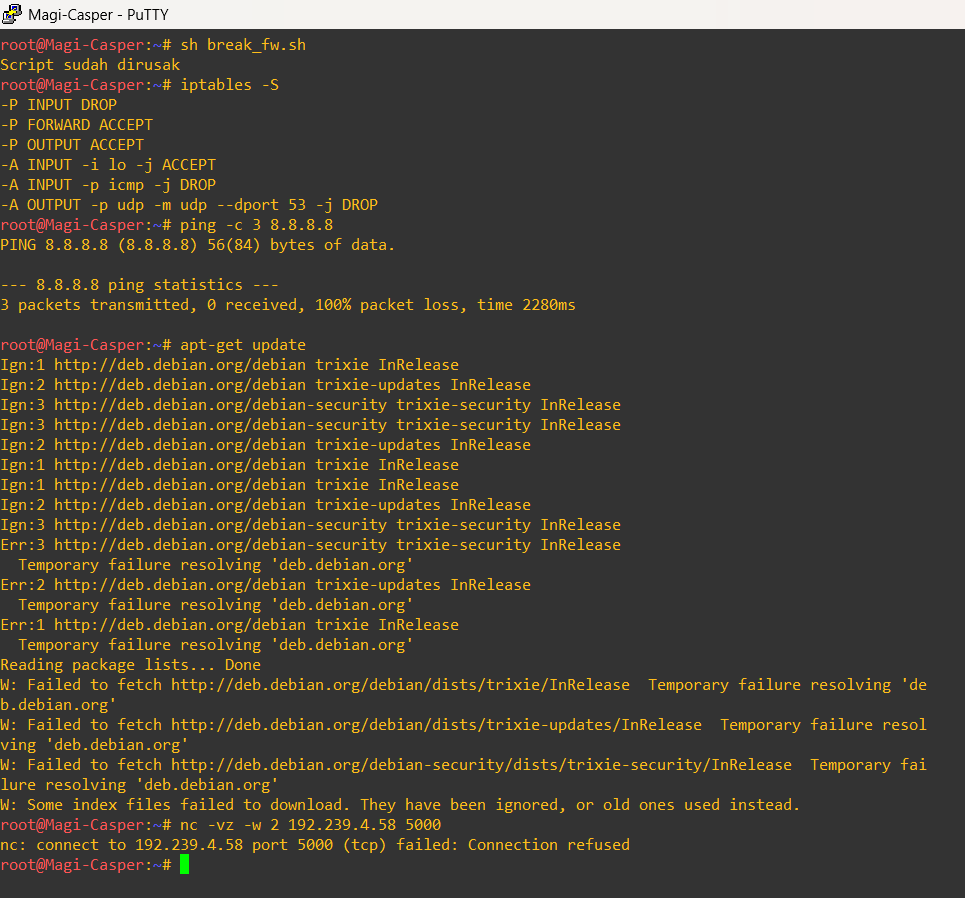

### 4.2 Kondisi Sesudah Perbaikan (`sh /root/no12.sh`)

Dijalankan setelah `sh /root/no12.sh` diterapkan pada `Magi-Casper`:

1. **Pada `Magi-Casper` (aturan pulih, `ping 8.8.8.8` & `apt-get update` berhasil):**

   ```sh
   iptables -S
   ping -c 3 8.8.8.8
   apt-get update
   ```

2. **Pada `Unit-00` (`192.239.4.68` — koneksi ke TCP `5000` Casper berhasil):**

   ```sh
   echo "Unit-00 lapor ke Casper" | nc -w 2 192.239.4.58 5000
   ```

3. **Pada `Lilith` atau `Magi-Balthasar` (`ping` masuk ke Casper tetap ditolak):**

   ```sh
   ping -c 2 192.239.4.58
   ```

Hasil yang diharapkan sesudah perbaikan:

* `ping -c 3 8.8.8.8` (`0% packet loss`) dan `apt-get update` pada `Magi-Casper` berjalan normal hingga selesai.
* Pesan dari `Unit-00` berhasil terkirim dan muncul pada terminal *listener* TCP `5000` di `Magi-Casper`.
* `ping -c 2 192.239.4.58` dari `Lilith` maupun `Magi-Balthasar` tetap menghasilkan `100% packet loss`.

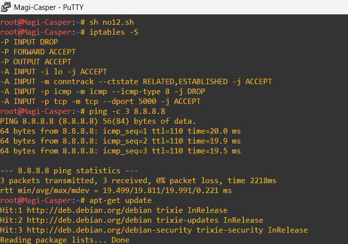

## 5. Kesimpulan

Kerusakan konektivitas pada `Magi-Casper` akibat `break_fw.sh` disebabkan oleh pemberlakuan *policy* `INPUT DROP` tanpa aturan `ESTABLISHED,RELATED`, pemblokiran paket DNS keluar (`UDP port 53`) pada chain `OUTPUT`, serta hilangnya aturan izin untuk TCP port `5000`. Melalui penerapan `/root/no12.sh`, seluruh konektivitas keluar (`ping` dan `apt-get update`) serta layanan TCP `5000` berhasil dipulihkan, sementara kebijakan keamanan `INPUT DROP` dan anti-`ping` masuk tetap terjaga.

## 6. Pemulihan setelah restart

Aturan `iptables` bersifat sementara di memori dan akan hilang apabila container `Magi-Casper` mengalami *restart*. Untuk memulihkan konfigurasi *firewall* sekaligus *hardening* Soal 11 & 12, jalankan kembali *script*:

```sh
sh /root/no12.sh
```
---

# SOAL 13 | Brankas Balthasar

Kelompok: K56 | Prefix IP: `192.239.x.x`

> Layanan informasi sensitif pada `Magi-Balthasar` berjalan di TCP port `5000` dan `5001` serta hanya boleh diakses oleh personel resmi (`Magi-Casper` dan para Pilot EVA). Konfigurasikan aturan *firewall* pada chain `INPUT` di `Magi-Balthasar` agar hanya mengizinkan akses ke port `5000` dan `5001` dari alamat IP yang terdaftar, serta **menolak seketika** (`TCP RST`, tanpa menggantung hingga *timeout*) seluruh percobaan koneksi tidak sah lainnya—termasuk dari tetangga satu *switch* (`Magi-Melchior`). Pastikan trafik jaringan lain dan `ping` keluar ke `8.8.8.8` tetap berjalan normal.

## 1. Tujuan

Menerapkan kontrol akses berbasis daftar putih (*whitelist*) dengan penolakan aktif (*TCP Reset*) pada layanan TCP `Magi-Balthasar`:

* Memasang aturan penyaringan pada chain `INPUT` di `Magi-Balthasar` (`192.239.4.59`) agar mencakup trafik lintas subnet maupun trafik satu segmen Layer-2 (`Switch-Terminal`).
* Mengizinkan koneksi masuk ke port TCP `5000` dan `5001` khusus dari alamat IP yang berwenang (`Magi-Casper`, `Unit-01`, `Unit-02`, `Unit-00`, dan `Sachiel`).
* Menolak secara instan setiap koneksi masuk tidak sah ke port `5000` dan `5001` menggunakan target `-j REJECT --reject-with tcp-reset` sehingga klien langsung menerima respons `Connection refused`.
* Mempertahankan *default policy* `INPUT ACCEPT` serta aturan `ESTABLISHED,RELATED` agar lalu lintas lain dan balasan `ping 8.8.8.8` dari `Magi-Balthasar` tidak terganggu.

## 2. Rancangan Alamat & Kebijakan Firewall

### Pemetaan Node Terkait

| Node | Peran | Subnet | IP Address | Status Akses TCP `5000,5001` |
|---|---|---|---|---|
| **Magi-Balthasar** | Server Layanan (Brankas) | `192.239.4.56/29` | `192.239.4.59` | Host Target (Listener TCP `5000` & `5001`) |
| **Magi-Casper** | Node MAGI Otorisasi | `192.239.4.56/29` | `192.239.4.58` | **Diizinkan (`ACCEPT`)** |
| **Unit-01** | Pilot EVA | `192.239.4.64/29` | `192.239.4.66` | **Diizinkan (`ACCEPT`)** |
| **Unit-02** | Pilot EVA | `192.239.4.64/29` | `192.239.4.67` | **Diizinkan (`ACCEPT`)** |
| **Unit-00** | Pilot EVA | `192.239.4.64/29` | `192.239.4.68` | **Diizinkan (`ACCEPT`)** |
| **Sachiel** | Node Otorisasi Cabang | `192.239.3.128/26` | `192.239.3.130` | **Diizinkan (`ACCEPT`)** |
| **Magi-Melchior** | Tetangga Satu Switch | `192.239.4.56/29` | `192.239.4.60` | **Ditolak Seketika (`REJECT tcp-reset`)** |
| **Lilith** | Host Zona Dogma | `192.239.4.72/29` | `192.239.4.74` | **Ditolak Seketika (`REJECT tcp-reset`)** |

### Urutan Aturan Chain `INPUT` pada `Magi-Balthasar`

| Urutan | Kondisi Pencocokan (`Match`) | Target | Keterangan |
|---|---|---|---|
| **1** | `-i lo` | `ACCEPT` | Mengizinkan komunikasi internal antarproses pada interface *loopback*. |
| **2** | `-m conntrack --ctstate ESTABLISHED,RELATED` | `ACCEPT` | Mengizinkan paket balasan dari sesi keluar yang dimulai oleh `Magi-Balthasar`. |
| **3–7** | `-p tcp -s <IP_RESMI> -m multiport --dports 5000,5001` | `ACCEPT` | Mengizinkan koneksi TCP ke port `5000` dan `5001` dari `192.239.4.58`, `.4.66`, `.4.67`, `.4.68`, dan `.3.130`. |
| **8** | `-p tcp -m multiport --dports 5000,5001` | `REJECT --reject-with tcp-reset` | Mengirim paket `TCP RST` seketika untuk menolak koneksi tidak sah ke port `5000` dan `5001`. |
| **Policy** | Default Policy `INPUT` | `ACCEPT` | Membiarkan lalu lintas jaringan lain (seperti `ping` dan layanan di luar port tersebut) berjalan normal. |

## 3. Konfigurasi

### 3.1 Magi-Balthasar – `/root/no13.sh`

Pastikan layanan *listener* TCP port `5000` dan `5001` pada `Magi-Balthasar` (dari `balthasar.sh`) sedang berjalan, kemudian buat dan jalankan *script* `/root/no13.sh`:

```sh
cat << 'EOF' > /root/no13.sh
#!/bin/sh
set -e

# Modul 5 - Soal Nomor 13
# Node: Magi-Balthasar (192.239.4.59)

# Reset chain INPUT agar bersih & idempoten
iptables -F INPUT
iptables -P INPUT ACCEPT

# Izinkan loopback & koneksi yang sudah terbentuk
iptables -A INPUT -i lo -j ACCEPT
iptables -A INPUT -m conntrack --ctstate ESTABLISHED,RELATED -j ACCEPT

# Daftar IP yang diizinkan ke TCP 5000 & 5001:
# - Magi-Casper: 192.239.4.58
# - Pilot: Unit-01 (.4.66), Unit-02 (.4.67), Unit-00 (.4.68), Sachiel (.3.130)
for SRC in 192.239.4.58 192.239.4.66 192.239.4.67 192.239.4.68 192.239.3.130; do
    iptables -A INPUT -p tcp -s "$SRC" -m multiport --dports 5000,5001 -j ACCEPT
done

# Tolak seketika (TCP RST) semua koneksi lain ke port 5000 & 5001
iptables -A INPUT -p tcp -m multiport --dports 5000,5001 -j REJECT --reject-with tcp-reset
EOF

chmod +x /root/no13.sh
sh /root/no13.sh
```

## 4. Pembuktian

### 4.1 Magi-Balthasar (Aturan Firewall & Ping Keluar)

Dijalankan pada terminal `Magi-Balthasar`:

```sh
iptables -S
iptables -L INPUT -n -v
ping -c 3 8.8.8.8
```

Hasil yang diharapkan:

* `iptables -S` menampilkan kelima aturan `ACCEPT` untuk IP sumber berwenang yang diikuti oleh aturan `-A INPUT -p tcp -m multiport --dports 5000,5001 -j REJECT --reject-with tcp-reset`.
* `ping -c 3 8.8.8.8` dari `Magi-Balthasar` berhasil (`0% packet loss`).

### 4.2 Pengujian Akses Resmi & Penolakan Seketika (`Unit-01`, `Lilith`, & `Magi-Melchior`)

1. **Dari `Unit-01` (`192.239.4.66` — IP Diizinkan):**

   ```sh
   echo "Unit-01 akses 5000" | nc -w 2 192.239.4.59 5000
   echo "Unit-01 akses 5001" | nc -w 2 192.239.4.59 5001
   ```

2. **Dari `Lilith` (`192.239.4.74` — Beda Subnet, Tidak Diizinkan):**

   ```sh
   nc -vz 192.239.4.59 5000
   nc -vz 192.239.4.59 5001
   ```

   *(Apabila menggunakan `nc` versi BusyBox tanpa opsi `-v`, jalankan `echo "tes" | nc 192.239.4.59 5000; echo $?` yang langsung selesai dalam $< 1$ detik dengan exit code `1`.)*

3. **Dari `Magi-Melchior` (`192.239.4.60` — Tetangga Satu Switch, Tidak Diizinkan):**

   ```sh
   nc -vz 192.239.4.59 5000
   nc -vz 192.239.4.59 5001
   ```

Hasil yang diharapkan:

* Pengiriman pesan dari `Unit-01` ke port `5000` dan `5001` **berhasil** serta pesan `Unit-01 akses 5000` dan `Unit-01 akses 5001` tercatat pada *listener* / log di `Magi-Balthasar`.
* Percobaan koneksi dari `Lilith` maupun `Magi-Melchior` ke port `5000` dan `5001` **langsung ditolak seketika** (`Connection refused` / exit code `1` dalam waktu $< 1$ detik tanpa menunggu *timeout*).

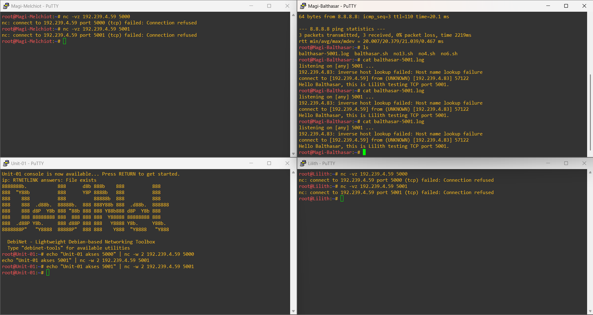

## 5. Kesimpulan

Konfigurasi *firewall* pada chain `INPUT` di `Magi-Balthasar` berhasil membatasi akses layanan TCP port `5000` dan `5001` secara selektif hanya untuk `Magi-Casper` dan keempat Pilot EVA. Penggunaan target `REJECT --reject-with tcp-reset` memastikan seluruh percobaan akses tidak sah—baik lintas subnet (`Lilith`) maupun dari tetangga satu *switch* (`Magi-Melchior`)—langsung diputus seketika dengan respons `TCP RST` (`Connection refused`), sementara lalu lintas normal dan `ping` keluar tetap berjalan lancar.

## 6. Pemulihan setelah restart

Aturan `iptables` bersifat sementara di memori dan akan terhapus apabila container `Magi-Balthasar` mengalami *restart*. Untuk memulihkan aturan pembatasan akses tersebut, jalankan kembali *script*:

```sh
sh /root/no13.sh
```
---

# SOAL 14 | Jam Kunjungan `Pen-Pen`

Kelompok: K56 | Prefix IP: `192.239.x.x`

> Akses menuju `Pen-Pen` (`192.239.3.194`) untuk layanan HTTP (TCP port `80`) dan pengecekan `ping` (`ICMP Echo Request`) harus dibatasi berdasarkan peran serta jam operasional. Konfigurasikan aturan *firewall* berbasis waktu (`-m time`) pada `Pen-Pen` dengan ketentuan: kelompok **Pilot** hanya diizinkan pada pukul `08.00 – 16.00 WIB` (Senin–Jumat), **Staf Geofront** pada pukul `17.00 – 23.00 WIB` (setiap hari), kelompok **Terduga Dummy System** selalu ditolak sepanjang waktu, dan kelompok lainnya bebas mengakses tanpa batasan waktu. Buktikan perilaku akses pada kondisi jadwal aktif maupun di luar jadwal.

## 1. Tujuan

Menerapkan pengendalian akses berbasis waktu (*time-based firewall*) menggunakan modul `time` pada `iptables` di `Pen-Pen`:

- Mengarahkan trafik masuk `ICMP Echo Request` (`ping`) dan `TCP port 80` pada `Pen-Pen` (`192.239.3.194`) ke *custom chain* `PENPEN_ACL`.
- Mengonversi seluruh jadwal operasional dari zona waktu **WIB (UTC+7)** ke zona waktu sistem standar `iptables` yaitu **UTC** ($\text{UTC} = \text{WIB} - 7\text{ jam}$).
- Memblokir secara permanen (`DROP`) seluruh trafik `ping` dan HTTP dari kelompok **Terduga Dummy System** (`Entry-Plug`, `Dummy-Plug`, dan `Spy`).
- Membatasi akses **Pilot** (`Unit-01`, `Unit-02`, `Unit-00`, `Sachiel`) hanya pada `01:00 – 09:00 UTC` hari Senin–Jumat, serta **Staf Geofront** (`Lilith`, `Adam`) hanya pada `10:00 – 16:00 UTC` setiap hari.
- Membuktikan bahwa permintaan dari Pilot dan Staf berhasil saat berada di dalam rentang jadwal dan ditolak saat di luar rentang jadwal, sementara Terduga Dummy System selalu ditolak.

## 2. Rancangan Alamat & Kebijakan Jadwal Firewall

### Pemetaan Kelompok Node & Konversi Jadwal (WIB ke UTC)

| Kelompok Peran | Daftar Node & IP Address | Jadwal Akses (WIB) | Jadwal Konversi (`iptables` UTC) | Kebijakan di Luar Jadwal |
|---|---|---|---|---|
| **Terduga Dummy System** | `Entry-Plug` (`192.239.4.50`)<br>`Dummy-Plug` (`192.239.4.51`)<br>`Spy` (`192.239.4.102`) | Tidak ada (Diblokir penuh) | Selalu `DROP` | `DROP` |
| **Pilot** | `Unit-01` (`192.239.4.66`)<br>`Unit-02` (`192.239.4.67`)<br>`Unit-00` (`192.239.4.68`)<br>`Sachiel` (`192.239.3.130`) | `08.00 – 16.00 WIB`<br>(Senin – Jumat) | `01:00 – 09:00 UTC`<br>(`Mon,Tue,Wed,Thu,Fri`) | `DROP` |
| **Staf Geofront** | `Lilith` (`192.239.4.74`)<br>`Adam` (`192.239.4.75`) | `17.00 – 23.00 WIB`<br>(Setiap hari) | `10:00 – 16:00 UTC`<br>(Setiap hari) | `DROP` |
| **Lainnya** | Seluruh IP di luar daftar di atas | Tanpa batasan waktu | Tanpa batasan waktu | `RETURN` $\rightarrow$ `ACCEPT` |

### Alur Evaluasi Chain `INPUT` & `PENPEN_ACL` pada `Pen-Pen`

1. Pada chain `INPUT`, trafik *loopback* (`-i lo`) dan paket balasan koneksi (`ESTABLISHED,RELATED`) diizinkan terlebih dahulu.
2. Paket `ICMP Echo Request` (`-p icmp --icmp-type echo-request`) dan paket `TCP port 80` (`-p tcp --dport 80`) dilompatkan (`-j PENPEN_ACL`) untuk diperiksa terhadap daftar IP dan jadwal waktu.
3. Jika IP sumber tidak termasuk dalam daftar *Dummy System*, *Pilot*, maupun *Staf Geofront*, aturan terakhir pada `PENPEN_ACL` (`-j RETURN`) mengembalikan paket ke chain `INPUT` dengan kebijakan *default* `ACCEPT`.

## 3. Konfigurasi

### 3.1 Pen-Pen – `/root/no14.sh`

Pastikan layanan HTTP pada TCP port `80` di `Pen-Pen` (dari konfigurasi sebelumnya) tetap aktif, lalu buat dan jalankan *script* `/root/no14.sh`:

```sh
cat << 'EOF' > /root/no14.sh
#!/bin/sh
set -e

# Modul 5 - Soal Nomor 14
# Node: Pen-Pen (192.239.3.194)

# Jadwal dalam UTC (WIB - 7 jam)
PILOT_START="01:00"
PILOT_STOP="09:00"
PILOT_DAYS="Mon,Tue,Wed,Thu,Fri"
STAF_START="10:00"
STAF_STOP="16:00"

# Reset chain INPUT & custom chain PENPEN_ACL
iptables -F INPUT
iptables -P INPUT ACCEPT
iptables -F PENPEN_ACL 2>/dev/null || iptables -N PENPEN_ACL

# Izinkan loopback & koneksi yang sudah terbentuk
iptables -A INPUT -i lo -j ACCEPT
iptables -A INPUT -m conntrack --ctstate ESTABLISHED,RELATED -j ACCEPT

# Arahkan trafik ping & TCP 80 ke chain PENPEN_ACL
iptables -A INPUT -p icmp --icmp-type echo-request -j PENPEN_ACL
iptables -A INPUT -p tcp --dport 80 -j PENPEN_ACL

# 1. Terduga Dummy System: Entry-Plug (.4.50), Dummy-Plug (.4.51), Spy (.4.102) -> Selalu ditolak
for IP in 192.239.4.50 192.239.4.51 192.239.4.102; do
    iptables -A PENPEN_ACL -s "$IP" -j DROP
done

# 2. Pilot: Unit-01 (.4.66), Unit-02 (.4.67), Unit-00 (.4.68), Sachiel (.3.130)
for IP in 192.239.4.66 192.239.4.67 192.239.4.68 192.239.3.130; do
    iptables -A PENPEN_ACL -s "$IP" -m time --timestart "$PILOT_START" --timestop "$PILOT_STOP" --weekdays "$PILOT_DAYS" -j ACCEPT
    iptables -A PENPEN_ACL -s "$IP" -j DROP
done

# 3. Staf Geofront: Lilith (.4.74), Adam (.4.75)
for IP in 192.239.4.74 192.239.4.75; do
    iptables -A PENPEN_ACL -s "$IP" -m time --timestart "$STAF_START" --timestop "$STAF_STOP" -j ACCEPT
    iptables -A PENPEN_ACL -s "$IP" -j DROP
done

# 4. Lainnya -> RETURN ke INPUT (ACCEPT)
iptables -A PENPEN_ACL -j RETURN
EOF

chmod +x /root/no14.sh
sh /root/no14.sh
```

## 4. Pembuktian

Pengujian dilakukan dalam dua skenario waktu dengan menyesuaikan sementara parameter variabel jadwal pada `/root/no14.sh` terhadap waktu UTC sistem (`date -u`) tanpa mengubah jam sistem host.

### 4.1 Kondisi A — Jadwal Cocok dengan Jam Sekarang (Pilot & Staf Diizinkan)

1. **Pada `Pen-Pen`** — periksa jam UTC saat ini (`date -u`), sesuaikan sementara rentang jam uji (misalnya `07:00 – 08:00 UTC` hari `Thu`) menggunakan `sed`, lalu jalankan ulang `/root/no14.sh`:

   ```sh
   date -u
   sed -i 's/PILOT_START=.*/PILOT_START="07:00"/' /root/no14.sh
   sed -i 's/PILOT_STOP=.*/PILOT_STOP="08:00"/' /root/no14.sh
   sed -i 's/PILOT_DAYS=.*/PILOT_DAYS="Thu"/' /root/no14.sh
   sed -i 's/STAF_START=.*/STAF_START="07:00"/' /root/no14.sh
   sed -i 's/STAF_STOP=.*/STAF_STOP="08:00"/' /root/no14.sh
   sh /root/no14.sh
   head -n 12 /root/no14.sh
   ```

2. **Uji `ping` ke `Pen-Pen` (`192.239.3.194`) dari ketiga kelompok node:**

   - **Dari `Unit-01` (`192.239.4.66` — Pilot):**
     ```sh
     ping -c 2 192.239.3.194
     ```
   - **Dari `Lilith` (`192.239.4.74` — Staf Geofront):**
     ```sh
     ping -c 2 192.239.3.194
     ```
   - **Dari `Spy` (`192.239.4.102` — Terduga Dummy System):**
     ```sh
     ping -c 2 192.239.3.194
     ```

Hasil yang diharapkan pada Kondisi A:

- `ping` dari `Unit-01` (Pilot) dan `Lilith` (Staf Geofront) ke `192.239.3.194` **berhasil** (`0% packet loss`).
- `ping` dari `Spy` (Terduga Dummy System) ke `192.239.3.194` **gagal** (`100% packet loss`).

Screenshot:


### 4.2 Kondisi B — Jadwal Tidak Cocok dengan Jam Sekarang (Pilot & Staf Ditolak)

1. **Pada `Pen-Pen`** — geser sementara variabel jadwal ke luar jam saat ini (misalnya `20:00 – 21:00 UTC`), lalu jalankan ulang `/root/no14.sh`:

   ```sh
   sed -i 's/PILOT_START=.*/PILOT_START="20:00"/' /root/no14.sh
   sed -i 's/PILOT_STOP=.*/PILOT_STOP="21:00"/' /root/no14.sh
   sed -i 's/STAF_START=.*/STAF_START="20:00"/' /root/no14.sh
   sed -i 's/STAF_STOP=.*/STAF_STOP="21:00"/' /root/no14.sh
   sh /root/no14.sh
   head -n 12 /root/no14.sh
   ```

2. **Uji ulang `ping` ke `Pen-Pen` (`192.239.3.194`) dari ketiga kelompok node:**

   - **Dari `Unit-01` (`192.239.4.66`):** `ping -c 2 192.239.3.194`
   - **Dari `Lilith` (`192.239.4.74`):** `ping -c 2 192.239.3.194`
   - **Dari `Spy` (`192.239.4.102`):** `ping -c 2 192.239.3.194`

Hasil yang diharapkan pada Kondisi B:

- Seluruh pengujian `ping` dari `Unit-01`, `Lilith`, maupun `Spy` ke `192.239.3.194` **gagal** (`100% packet loss`).

Screenshot:


### 4.3 Pengembalian Variabel Jadwal ke Ketentuan Soal Asli

Setelah kedua kondisi pengujian selesai didokumentasikan, variabel jadwal pada `/root/no14.sh` dikembalikan ke nilai ketentuan soal (`01:00–09:00 UTC` Senin–Jumat untuk Pilot dan `10:00–16:00 UTC` setiap hari untuk Staf Geofront) dan diterapkan ulang:

```sh
sed -i 's/PILOT_START=.*/PILOT_START="01:00"/' /root/no14.sh
sed -i 's/PILOT_STOP=.*/PILOT_STOP="09:00"/' /root/no14.sh
sed -i 's/PILOT_DAYS=.*/PILOT_DAYS="Mon,Tue,Wed,Thu,Fri"/' /root/no14.sh
sed -i 's/STAF_START=.*/STAF_START="10:00"/' /root/no14.sh
sed -i 's/STAF_STOP=.*/STAF_STOP="16:00"/' /root/no14.sh
sh /root/no14.sh
iptables -S PENPEN_ACL
```

Screenshot:


## 5. Kesimpulan

Penerapan *custom chain* `PENPEN_ACL` yang dipadukan dengan modul `-m time` pada `Pen-Pen` (`192.239.3.194`) berhasil membatasi akses layanan `ICMP Echo Request` (`ping`) dan `TCP port 80` sesuai peran serta jadwal operasional masing-masing kelompok. Konversi jadwal WIB ke UTC (`WIB - 7 jam`) memastikan evaluasi waktu oleh `iptables` berjalan akurat: kelompok *Dummy System* selalu ditolak, sedangkan *Pilot* dan *Staf Geofront* hanya dapat mengakses pada jam yang telah ditentukan.

## 6. Pemulihan setelah restart

Aturan `iptables` bersifat sementara di memori dan akan hilang apabila container `Pen-Pen` mengalami *restart*. Untuk memulihkan kebijakan pembatasan waktu sesuai jadwal soal, jalankan kembali *script*:

```sh
sh /root/no14.sh
```

---

# SOAL 17 | Pengalihan Trafik TCP (DNAT)

Kelompok: K56 | Prefix IP: `192.239.x.x`

> Jalur komunikasi dari terminal pengawasan perlu dialihkan secara diam-diam tanpa mengubah konfigurasi pada sisi klien. Konfigurasikan aturan Destination NAT (DNAT) pada router gateway `Fuyutsuki` agar seluruh trafik **TCP** dari `Magi-Casper` yang ditujukan ke `Zeruel` dialihkan menuju `Pen-Pen`, sementara trafik non-TCP (seperti ICMP `ping`) tetap diteruskan ke `Zeruel`. Buktikan pengalihan koneksi TCP serta pencatatan translasi pada tabel `nat` dan `conntrack`.

## 1. Tujuan

Menerapkan dan memverifikasi pengalihan trafik berbasis Destination NAT (DNAT):

- Router `Fuyutsuki` mengalihkan paket **TCP** dari `Magi-Casper` (`192.239.4.58`) menuju tujuan asli `Zeruel` (`192.239.4.82`) ke alamat tujuan baru `Pen-Pen` (`192.239.3.195`).
- Klien `Magi-Casper` tetap mengakses IP `Zeruel` (`192.239.4.82`) tanpa mengetahui adanya pengalihan.
- Trafik non-TCP (ICMP `ping`) dari `Magi-Casper` ke `192.239.4.82` tidak ikut dialihkan dan tetap mencapai `Zeruel`.
- Membuktikan translasi paket melalui `iptables -t nat` dan `conntrack` pada `Fuyutsuki`, serta penerimaan koneksi TCP pada `Pen-Pen`.

## 2. Rancangan Alamat & Alur Trafik

### Pemetaan Node & Interface Terkait

| Node | Peran | Subnet | IP Address | Gateway |
|---|---|---|---|---|
| **Magi-Casper** | Sumber Trafik (Klien) | `192.239.4.56/29` | `192.239.4.58` | `192.239.4.57` (`Fuyutsuki`) |
| **Fuyutsuki** | Router Pelaksana DNAT | `192.239.4.56/29` (`eth1`)<br>`192.239.4.160/30` (`eth2`) | `192.239.4.57` (`eth1`)<br>`192.239.4.161` (`eth2`) | `192.239.4.121` (`Gendou`) |
| **Zeruel** | Tujuan Asli (Host Monolith) | `192.239.4.80/29` | `192.239.4.82` | `192.239.4.81` (`Shigeru`) |
| **Pen-Pen** | Tujuan Pengalihan (Host Cabang Maya) | `192.239.3.192/27` | `192.239.3.195` | `192.239.3.193` (`Maya`) |

### Skenario Translasi Paket

| Sumber (`-s`) | Tujuan Awal (`-d`) | Protokol | Aksi di `Fuyutsuki` (`PREROUTING`) | Tujuan Akhir |
|---|---|---|---|---|
| `192.239.4.58` (`Magi-Casper`) | `192.239.4.82` (`Zeruel`) | **TCP** (`-p tcp`) | `DNAT --to-destination 192.239.3.195` | `192.239.3.195` (`Pen-Pen`) |
| `192.239.4.58` (`Magi-Casper`) | `192.239.4.82` (`Zeruel`) | **ICMP** (`ping`) | Tidak cocok rule DNAT (diteruskan normal) | `192.239.4.82` (`Zeruel`) |

## 3. Konfigurasi

### 3.1 Fuyutsuki – `/root/no17.sh`

```sh
#!/bin/sh
set -e

# Modul 5 - Soal Nomor 17
# Router: Fuyutsuki (Gateway Switch-Terminal)
# Sumber: Magi-Casper (192.239.4.58)
# Tujuan Asli: Zeruel (192.239.4.82) -> Dialihkan ke Pen-Pen (192.239.3.195)

# Pasang utilitas conntrack jika belum tersedia
command -v conntrack >/dev/null 2>&1 || (apt-get update -qq && apt-get install -y -qq conntrack)

# Bersihkan tabel nat agar idempoten
iptables -t nat -F

# Alihkan trafik TCP dari Magi-Casper ke Zeruel menuju Pen-Pen
iptables -t nat -A PREROUTING -s 192.239.4.58 -d 192.239.4.82 -p tcp -j DNAT --to-destination 192.239.3.195
```

Berikan izin eksekusi dan jalankan *script* pada `Fuyutsuki`:

```sh
chmod +x /root/no17.sh
sh /root/no17.sh
```

### 3.2 Pen-Pen & Zeruel – Listener Pengujian

Untuk membuktikan bahwa koneksi TCP benar-benar mendarat di `Pen-Pen` dan bukan di `Zeruel`, jalankan *listener* TCP port `9000` di kedua host:

```sh
pkill nc 2>/dev/null || true
(nc -lk -p 9000 || nc -lk 9000) >/dev/null 2>&1 &
ss -tulpn | grep 9000
```

## 4. Pembuktian

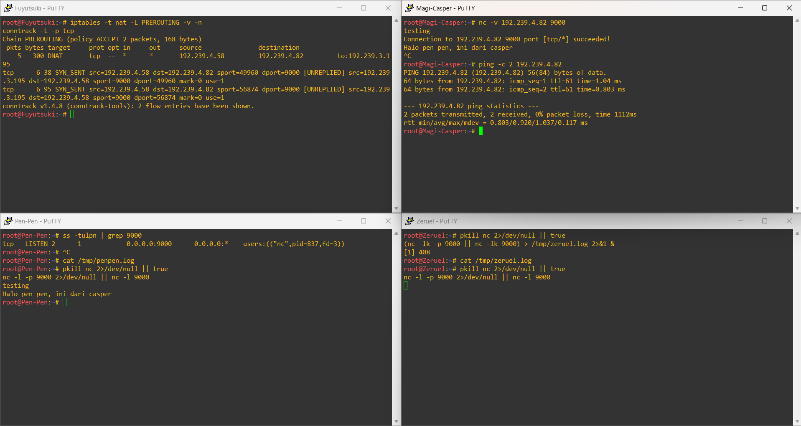

## 5. Kesimpulan

Router `Fuyutsuki` berhasil menerapkan aturan `DNAT` pada chain `PREROUTING` tabel `nat`: seluruh trafik **TCP** dari `Magi-Casper` (`192.239.4.58`) yang mengarah ke `Zeruel` (`192.239.4.82`) otomatis dialihkan ke `Pen-Pen` (`192.239.3.195`), sedangkan trafik non-TCP seperti `ping` tetap diteruskan langsung menuju `Zeruel`.

## 6. Pemulihan setelah restart

Aturan `iptables` bersifat sementara di memori dan akan hilang apabila router `Fuyutsuki` mengalami *restart*. Untuk memulihkan konfigurasi, jalankan kembali *script*:

```sh
sh /root/no17.sh
```

---

# SOAL 18 | Firewall Forwarding Gateway Zona Monolith

Kelompok: K56 | Prefix IP: `192.239.x.x`

> Zona Monolith perlu diamankan dari akses eksternal yang tidak sah tanpa memutus konektivitas keluar maupun pengecekan dari terminal pengawasan. Konfigurasikan aturan *firewall* pada chain `FORWARD` di router gateway `Shigeru` agar memblokir seluruh trafik masuk dari arah jaringan eksternal (`Gendou` melalui `eth0`), kecuali paket balasan koneksi (`ESTABLISHED,RELATED`) serta permintaan `ping` (`ICMP Echo Request`) yang berasal dari subnet `Switch-Terminal`. Buktikan bahwa trafik dari `Switch-Terminal` dan trafik keluar dari `Zeruel` tetap berjalan, sementara akses dari zona eksternal lain terblokir.

## 1. Tujuan

Menerapkan dan memverifikasi penyaringan paket (*packet filtering*) pada gateway Zona Monolith (`Shigeru`):

- Mengizinkan paket balasan dari koneksi yang sudah terbangun (`ESTABLISHED,RELATED`) melewati chain `FORWARD`.
- Mengizinkan trafik `ping` (`ICMP Echo Request`) masuk melalui interface eksternal `eth0` khusus yang berasal dari subnet `Switch-Terminal` (`192.239.4.56/29`).
- Memblokir (`DROP`) seluruh trafik masuk lainnya yang datang dari arah jaringan eksternal/backbone melalui `eth0`.
- Tetap mengizinkan trafik keluar dari host internal Zona Monolith (`Zeruel`) menuju jaringan luar.

## 2. Rancangan Alamat & Kebijakan Firewall

### Pemetaan Node & Interface Terkait

| Node | Peran | Subnet | IP Address | Gateway / Interface |
|---|---|---|---|---|
| **Shigeru** | Router Firewall Zona Monolith | `192.239.4.124/30` (`eth0`)<br>`192.239.4.80/29` (`eth1`)<br>`192.239.4.168/30` (`eth2`) | `192.239.4.126` (`eth0`)<br>`192.239.4.81` (`eth1`)<br>`192.239.4.169` (`eth2`) | `192.239.4.125` (`Gendou`) |
| **Zeruel** | Host Internal Zona Monolith | `192.239.4.80/29` | `192.239.4.82` | `192.239.4.81` (`Shigeru`) |
| **Magi-Casper** | Host Zona Terminal (Diizinkan Ping) | `192.239.4.56/29` | `192.239.4.58` | `192.239.4.57` (`Fuyutsuki`) |
| **Lilith** | Host Zona Dogma (Eksternal / Diblokir) | `192.239.4.72/29` | `192.239.4.74` | `192.239.4.73` (`Toji`) |

### Urutan Aturan Chain `FORWARD` pada `Shigeru`

| Urutan | Kondisi Pencocokan (`Match`) | Target | Keterangan |
|---|---|---|---|
| **1** | `-m conntrack --ctstate ESTABLISHED,RELATED` | `ACCEPT` | Mengizinkan paket balasan dari koneksi keluar (misal `Zeruel` ke internet). |
| **2** | `-i eth0 -s 192.239.4.56/29 -p icmp --icmp-type echo-request` | `ACCEPT` | Pengecualian untuk `ping` masuk dari subnet `Switch-Terminal`. |
| **3** | `-i eth0` | `DROP` | Memblokir seluruh trafik masuk eksternal lainnya dari arah `Gendou`. |

## 3. Konfigurasi

### 3.1 Shigeru – `/root/no18.sh`

```sh
#!/bin/sh
set -e

# Modul 5 - Soal Nomor 18
# Router: Shigeru (Gateway Zona Monolith)

# Bersihkan chain FORWARD
iptables -F FORWARD
iptables -P FORWARD ACCEPT

# Izinkan trafik balasan (ESTABLISHED/RELATED)
iptables -A FORWARD -m conntrack --ctstate ESTABLISHED,RELATED -j ACCEPT

# Izinkan ping (ICMP Echo Request) masuk dari subnet Switch-Terminal (192.239.4.56/29)
iptables -A FORWARD -i eth0 -s 192.239.4.56/29 -p icmp --icmp-type echo-request -j ACCEPT

# Blokir seluruh trafik masuk eksternal lainnya dari arah Gendou (eth0)
iptables -A FORWARD -i eth0 -j DROP
```

Berikan izin eksekusi dan jalankan *script* pada `Shigeru`:

```sh
chmod +x /root/no18.sh
sh /root/no18.sh
```

## 4. Pembuktian

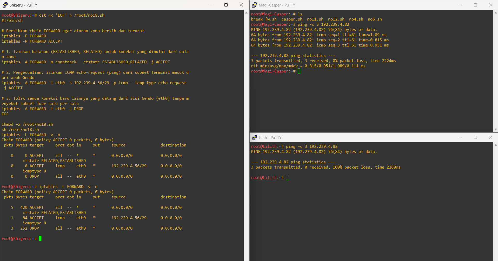

## 5. Kesimpulan

Router `Shigeru` berhasil mengamankan Zona Monolith menggunakan kebijakan *stateful firewall* pada chain `FORWARD`: seluruh paket masuk dari jaringan eksternal (`eth0`) diblokir, sementara komunikasi balasan koneksi keluar dari host internal (`Zeruel`) serta pengecualian `ICMP Echo Request` dari subnet `Switch-Terminal` (`192.239.4.56/29`) tetap dapat berjalan normal.

## 6. Pemulihan setelah restart

Aturan `iptables` bersifat sementara di memori dan akan terhapus apabila router `Shigeru` mengalami *restart*. Untuk memulihkan konfigurasi *firewall*, jalankan kembali *script*:

```sh
sh /root/no18.sh
```

---

# SOAL 19 | Isolasi Pengkhianat (Armisael)

Kelompok: K56 | Prefix IP: `192.239.x.x`

> Terdeteksi indikasi penyusupan pada node `Armisael` di dalam Zona Monolith. Isolasi seluruh lalu lintas jaringan masuk maupun keluar dari `Armisael` **tanpa mengubah konfigurasi apa pun di dalam container `Armisael`**. Pastikan tetangga satu *switch*-nya (`Zeruel`) tetap berfungsi normal dan dapat menjangkau `Lilith` maupun `Seele` (DNS TCP port `53`), sementara `Armisael` terputus sepenuhnya dari `Zeruel`, `Lilith`, dan `Seele`.

## 1. Tujuan

Menerapkan isolasi jaringan Layer-2 secara total terhadap node `Armisael` tanpa menyentuh konfigurasi internal node tersebut:

- Memutus seluruh komunikasi masuk dan keluar pada `Armisael` (`192.239.4.83/29`) melalui segmentasi VLAN pada `Switch-Monolith`.
- Memastikan konfigurasi IP, *routing*, dan *firewall* di dalam `Armisael` tetap utuh tanpa modifikasi.
- Mempertahankan konektivitas normal node tetangga (`Zeruel`) menuju gateway `Shigeru`, `Lilith` (TCP `9000`), dan `Seele` (`8.8.8.8` TCP `53`).
- Membuktikan bahwa lalu lintas dari maupun menuju `Armisael` seluruhnya gagal.

## 2. Rancangan Alamat & Pemetaan Port Switch

### Pemetaan Node & Layanan Terkait

| Node | Peran | Subnet | IP Address | Layanan / Port Uji |
|---|---|---|---|---|
| **Armisael** | Target Isolasi (Zona Monolith) | `192.239.4.80/29` | `192.239.4.83` | TCP `9000` (Listener) |
| **Zeruel** | Tetangga Satu Switch (Normal) | `192.239.4.80/29` | `192.239.4.82` | TCP `9000` (Listener) |
| **Shigeru** | Gateway Zona Monolith | `192.239.4.80/29` | `192.239.4.81` | Default Gateway |
| **Lilith** | Host Zona Dogma | `192.239.4.72/29` | `192.239.4.74` | TCP `9000` (Listener) |
| **Seele** | Server DNS Eksternal (via `NAT1`) | Eksternal | `8.8.8.8` | TCP `53` (DNS) |

### Pemetaan VLAN pada `Switch-Monolith` (GNS3)

| Port Switch | Interface | Perangkat Terhubung | VLAN ID | Tipe Port | Status Konektivitas |
|---|---|---|---|---|---|
| **Port `0`** | `e0` | `Shigeru` (`eth1`) | `1` | `access` | Terhubung ke segmen utama |
| **Port `1`** | `e1` | `Armisael` (`eth0`) | **`99`** | `access` | **Terisolasi (VLAN terpisah tanpa trunk/gateway)** |
| **Port `2`** | `e2` | `Zeruel` (`eth0`) | `1` | `access` | Terhubung ke segmen utama |

## 3. Konfigurasi

### 3.1 Switch-Monolith – Konfigurasi VLAN (GNS3)

Isolasi diterapkan pada perangkat Layer-2 (`Switch-Monolith`) di kanvas GNS3 agar tidak melanggar larangan mengubah konfigurasi di dalam `Armisael`:

1. Klik kanan perangkat **`Switch-Monolith`** pada GNS3 lalu pilih **Configure**.
2. Pada bagian **Settings**, pilih **Port `1`** (`e1` yang terhubung ke `Armisael`).
3. Ubah nilai **VLAN** dari `1` menjadi **`99`** dengan **Type** tetap `access`, lalu klik **Add** (atau **Modify**).
4. Pastikan pada tabel **Ports** tercatat:
   - Port `0` $\rightarrow$ VLAN `1` (`access`)
   - Port `1` $\rightarrow$ VLAN `99` (`access`)
   - Port `2` $\rightarrow$ VLAN `1` (`access`)
5. Klik **Apply**, kemudian klik **OK**.

### 3.2 Armisael, Zeruel, & Lilith – Listener Pengujian

Untuk menguji konektivitas layanan TCP antar node, nyalakan *listener* TCP port `9000` pada terminal **`Armisael`**, **`Zeruel`**, dan **`Lilith`**:

```sh
pkill nc 2>/dev/null || true
(nc -lk -p 9000 || nc -lk 9000) >/dev/null 2>&1 &
ss -tulpn | grep 9000
```

## 4. Pembuktian

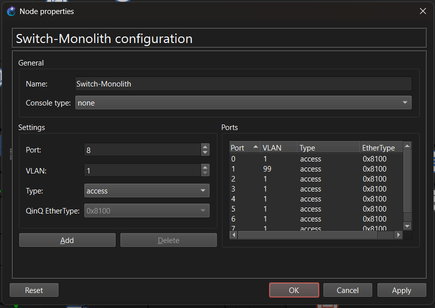
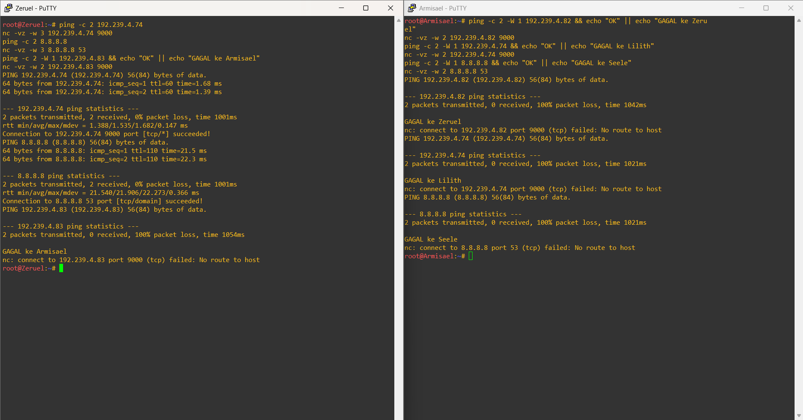

## 5. Kesimpulan

Pemisahan Port `1` (`Armisael`) ke dalam **VLAN `99`** pada `Switch-Monolith` berhasil mengisolasi `Armisael` sepenuhnya di lapisan Layer-2 tanpa mengubah konfigurasi internal di dalam node tersebut. Trafik dari dan menuju `Armisael` terputus total, sementara tetangganya (`Zeruel`) tetap dapat berkomunikasi normal dengan `Lilith` maupun `Seele`.

## 6. Pemulihan setelah restart

Konfigurasi VLAN pada `Switch-Monolith` tersimpan di dalam file proyek GNS3 (`.gns3`). Apabila proyek mengalami *restart*:

1. Pastikan konfigurasi port di `Switch-Monolith` masih menunjukkan **Port `1` $\rightarrow$ VLAN `99`** (jika proyek di-*reset* ke kondisi awal, ulangi langkah pada bagian 3.1).
2. Jalankan kembali *listener* pengujian pada `Armisael`, `Zeruel`, dan `Lilith`:

```sh
(nc -lk -p 9000 || nc -lk 9000) >/dev/null 2>&1 &
```

# SOAL 20 | Babak Final: Uji Kebakaran Geofront

Kelompok: K56 | Prefix IP: `192.239.x.x`

> Uji kebakaran Geofront: NERV harus bisa dibangun ulang dengan cepat. Pilih tiga node sendiri, minimal satu router. Di tiap node, simpan dulu rule dengan `iptables-save` ke `/root/<nama>.rules`. Lalu hapus semua rule iptables termasuk tabel `nat`, dan hapus rute yang kamu tambahkan sendiri. Pulihkan rule dengan `iptables-restore`, dan pulihkan rute dengan `/root/<nama>.sh`. Lakukan pemulihan itu dua kali berturut-turut. Hasilnya harus sama: rule dan rute tidak dobel, dan node berfungsi seperti semula. Buktikan jumlah baris `iptables -S` dan `iptables -t nat -S` sama setelah pemulihan pertama dan kedua. Buktikan juga node itu berfungsi lagi.

## 1. Tujuan

Menguji kesiapan dan sifat idempoten (*tidak menghasilkan duplikasi saat dijalankan berulang*) dari mekanisme pencadangan (*backup*) dan pemulihan (*restore*) jaringan pada 3 node terpilih:

- Mencadangkan seluruh aturan `iptables` (tabel `filter` dan `nat`) ke dalam berkas `/root/<nama>.rules` menggunakan `iptables-save`.
- Menyusun *script* pemulihan rute statis yang idempoten (`ip route replace`) pada `/root/<nama>.sh`.
- Mensimulasikan kondisi darurat dengan menghapus seluruh aturan `iptables` (termasuk tabel `nat`) serta rute statis pada ketiga node.
- Menjalankan proses pemulihan (`iptables-restore` dan `/root/<nama>.sh`) sebanyak **dua kali berturut-turut** dan membuktikan jumlah baris `iptables -S`, `iptables -t nat -S`, dan `ip r` identik tanpa duplikasi.
- Memverifikasi bahwa seluruh fungsi routing, DNAT, dan firewall pada ketiga node kembali berjalan normal seperti semula.

## 2. Rancangan Node, Cadangan Rule, & Rute Idempoten

### Pemetaan Node Terpilih (2 Router & 1 Host)

| Node | Tipe | Peran & Konfigurasi Aktif | File Cadangan Rule | Script Rute Idempoten |
|---|---|---|---|---|
| **Shigeru** | Router | Gateway Zona Monolith: aturan firewall `FORWARD` (Soal 18) + rute `default` & cabang `Makoto` (`192.239.4.88/29`) | `/root/shigeru.rules` | `/root/shigeru.sh` |
| **Fuyutsuki** | Router | Gateway Switch-Terminal: aturan `DNAT` tabel `nat` (Soal 17) + rute `default`, cabang `Maya` (`192.239.3.192/27`), & cabang `Toji` (`192.239.4.72/29`) | `/root/fuyutsuki.rules` | `/root/fuyutsuki.sh` |
| **Zeruel** | Host | Host Internal Zona Monolith: tabel `filter`/`nat` default + rute `default` via `Shigeru` (`192.239.4.81`) | `/root/zeruel.rules` | `/root/zeruel.sh` |

## 3. Konfigurasi

### 3.1 Cadangan Aturan Firewall (`iptables-save`)

Sebelum simulasi penghapusan dijalankan, pastikan seluruh aturan aktif (termasuk aturan Soal 17 pada `Fuyutsuki` dan Soal 18 pada `Shigeru`) telah diterapkan, lalu simpan ke file `.rules` di masing-masing node:

```sh
# Pada Shigeru
sh /root/no18.sh
iptables-save > /root/shigeru.rules

# Pada Fuyutsuki
sh /root/no17.sh
iptables-save > /root/fuyutsuki.rules

# Pada Zeruel
iptables-save > /root/zeruel.rules
```

### 3.2 Script Pemulihan Rute Idempoten (`/root/<nama>.sh`)

Perintah `ip route replace` digunakan pada setiap *script* agar rute statis dapat dipulihkan berulang kali tanpa menimbulkan *error* `File exists` maupun duplikasi entri tabel routing.

#### A. Node `Shigeru` – `/root/shigeru.sh`

```sh
#!/bin/sh
# Modul 5 - Babak Final Nomor 1 (Pemulihan Rute Idempoten)
# Node: Shigeru (/root/shigeru.sh)

ip route replace default via 192.239.4.125 dev eth0
ip route replace 192.239.4.88/29 via 192.239.4.170 dev eth2
```

#### B. Node `Fuyutsuki` – `/root/fuyutsuki.sh`

```sh
#!/bin/sh
# Modul 5 - Babak Final Nomor 1 (Pemulihan Rute Idempoten)
# Node: Fuyutsuki (/root/fuyutsuki.sh)

ip route replace default via 192.239.4.121 dev eth0
ip route replace 192.239.3.192/27 via 192.239.4.162 dev eth2
ip route replace 192.239.4.72/29 via 192.239.4.166 dev eth3
```

#### C. Node `Zeruel` – `/root/zeruel.sh`

```sh
#!/bin/sh
# Modul 5 - Babak Final Nomor 1 (Pemulihan Rute Idempoten)
# Node: Zeruel (/root/zeruel.sh)

ip route replace default via 192.239.4.81 dev eth0
```

Berikan izin eksekusi pada ketiga *script* tersebut:

```sh
chmod +x /root/shigeru.sh      # di Shigeru
chmod +x /root/fuyutsuki.sh    # di Fuyutsuki
chmod +x /root/zeruel.sh       # di Zeruel
```

## 4. Pembuktian

### 4.1 Simulasi Penghapusan & Pemulihan 2x Berturut-Turut

#### A. Pengujian pada `Shigeru`

```sh
# 1. Hapus semua rule iptables (termasuk nat) & rute statis
iptables -F && iptables -X && iptables -t nat -F && iptables -t nat -X
iptables -P INPUT ACCEPT && iptables -P FORWARD ACCEPT && iptables -P OUTPUT ACCEPT
ip route del default 2>/dev/null || true
ip route del 192.239.4.88/29 2>/dev/null || true

# 2. Pemulihan PERTAMA
iptables-restore < /root/shigeru.rules
sh /root/shigeru.sh
echo "=== PEMULIHAN 1 (Shigeru) ==="
echo "Baris filter: $(iptables -S | wc -l) | Baris nat: $(iptables -t nat -S | wc -l) | Baris route: $(ip r | wc -l)"

# 3. Pemulihan KEDUA berturut-turut
iptables-restore < /root/shigeru.rules
sh /root/shigeru.sh
echo "=== PEMULIHAN 2 (Shigeru) ==="
echo "Baris filter: $(iptables -S | wc -l) | Baris nat: $(iptables -t nat -S | wc -l) | Baris route: $(ip r | wc -l)"
iptables -S && iptables -t nat -S && ip r
```

#### B. Pengujian pada `Fuyutsuki`

```sh
# 1. Hapus semua rule iptables (termasuk nat) & rute statis
iptables -F && iptables -X && iptables -t nat -F && iptables -t nat -X
iptables -P INPUT ACCEPT && iptables -P FORWARD ACCEPT && iptables -P OUTPUT ACCEPT
ip route del default 2>/dev/null || true
ip route del 192.239.3.192/27 2>/dev/null || true
ip route del 192.239.4.72/29 2>/dev/null || true

# 2. Pemulihan PERTAMA
iptables-restore < /root/fuyutsuki.rules
sh /root/fuyutsuki.sh
echo "=== PEMULIHAN 1 (Fuyutsuki) ==="
echo "Baris filter: $(iptables -S | wc -l) | Baris nat: $(iptables -t nat -S | wc -l) | Baris route: $(ip r | wc -l)"

# 3. Pemulihan KEDUA berturut-turut
iptables-restore < /root/fuyutsuki.rules
sh /root/fuyutsuki.sh
echo "=== PEMULIHAN 2 (Fuyutsuki) ==="
echo "Baris filter: $(iptables -S | wc -l) | Baris nat: $(iptables -t nat -S | wc -l) | Baris route: $(ip r | wc -l)"
iptables -S && iptables -t nat -S && ip r
```

#### C. Pengujian pada `Zeruel`

```sh
# 1. Hapus semua rule iptables (termasuk nat) & rute statis
iptables -F && iptables -X && iptables -t nat -F && iptables -t nat -X
iptables -P INPUT ACCEPT && iptables -P FORWARD ACCEPT && iptables -P OUTPUT ACCEPT
ip route del default 2>/dev/null || true

# 2. Pemulihan PERTAMA
iptables-restore < /root/zeruel.rules
sh /root/zeruel.sh
echo "=== PEMULIHAN 1 (Zeruel) ==="
echo "Baris filter: $(iptables -S | wc -l) | Baris nat: $(iptables -t nat -S | wc -l) | Baris route: $(ip r | wc -l)"

# 3. Pemulihan KEDUA berturut-turut
iptables-restore < /root/zeruel.rules
sh /root/zeruel.sh
echo "=== PEMULIHAN 2 (Zeruel) ==="
echo "Baris filter: $(iptables -S | wc -l) | Baris nat: $(iptables -t nat -S | wc -l) | Baris route: $(ip r | wc -l)"
iptables -S && iptables -t nat -S && ip r
```

#### Hasil Perbandingan Jumlah Baris (Pemulihan 1 vs Pemulihan 2)

| Node | Baris `iptables -S` (Pemulihan 1 / 2) | Baris `iptables -t nat -S` (Pemulihan 1 / 2) | Baris `ip r` (Pemulihan 1 / 2) | Status Konsistensi |
|---|---|---|---|---|
| **Shigeru** | `6` / `6` | `4` / `4` | `5` / `5` | Identik (Tidak Dobel) |
| **Fuyutsuki** | `3` / `3` | `5` / `5` | `7` / `7` | Identik (Tidak Dobel) |
| **Zeruel** | `3` / `3` | `4` / `4` | `2` / `2` | Identik (Tidak Dobel) |

| Node | Screenshot |
|---|---|
| `Shigeru` (penghapusan & pemulihan 2x berturut-turut) | 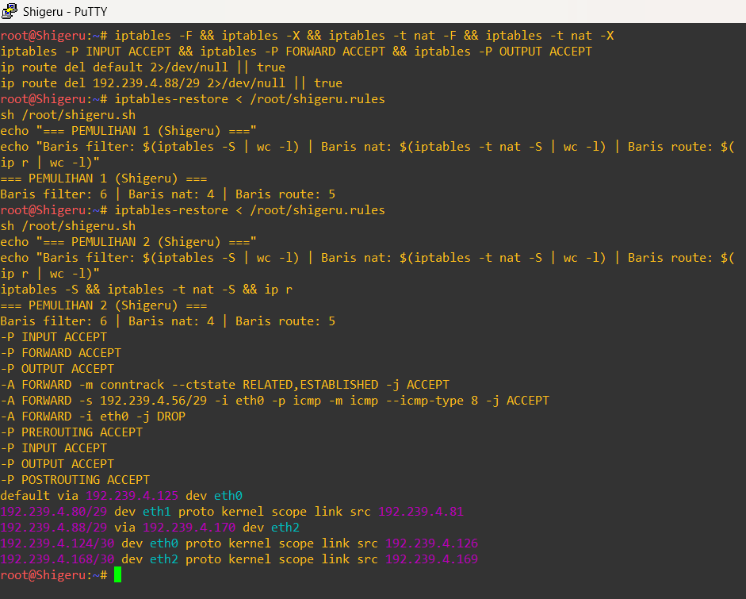 |
| `Fuyutsuki` (penghapusan & pemulihan 2x berturut-turut) | 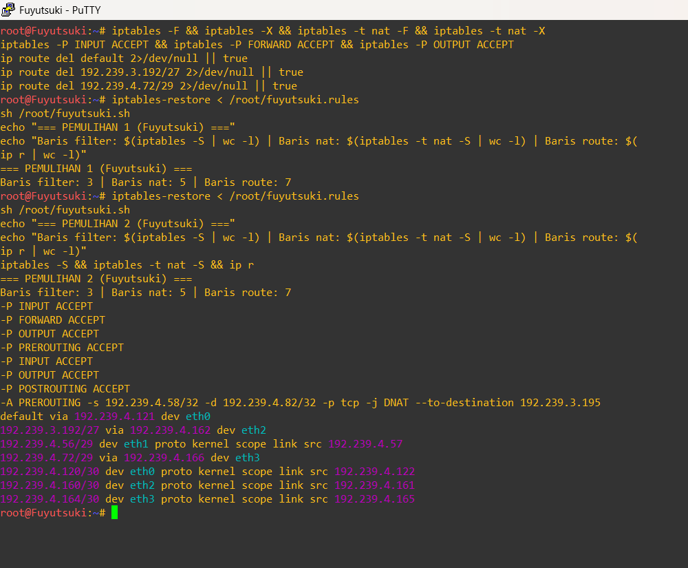 |
| `Zeruel` (penghapusan & pemulihan 2x berturut-turut) | 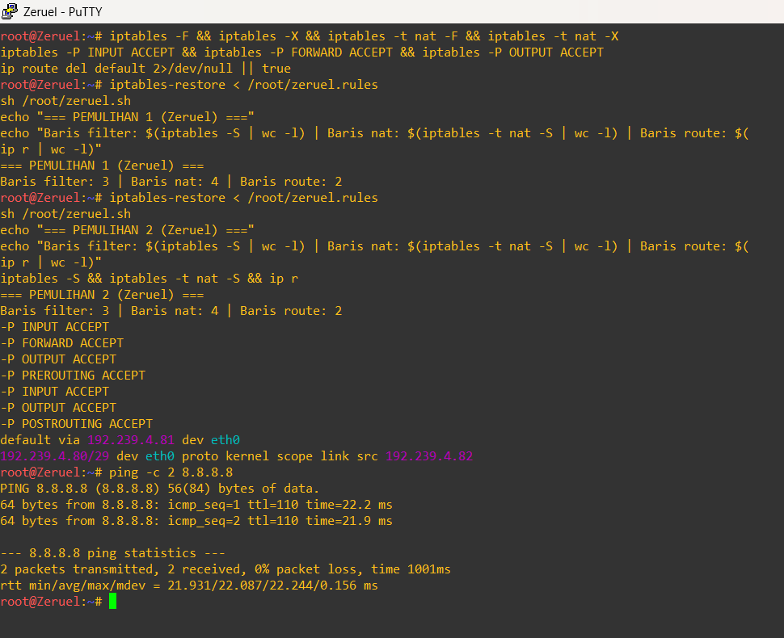 |

### 4.2 Verifikasi Fungsi Node Pasca Pemulihan

1. **Di `Zeruel`** (membuktikan *default route* `Zeruel` serta *forwarding* keluar `Shigeru` kembali normal):

   ```sh
   ping -c 2 8.8.8.8
   ```

2. **Di `Magi-Casper`** *(dengan listener TCP port `9000` aktif di `Pen-Pen`)* — membuktikan rute cabang dan aturan `DNAT` pada `Fuyutsuki` serta pengecualian firewall `Shigeru` kembali aktif:

   ```sh
   ping -c 2 192.239.4.82
   nc -vz -w 3 192.239.4.82 9000
   ```

3. **Di `Lilith`** — membuktikan pemblokiran trafik masuk eksternal pada firewall `Shigeru` kembali berjalan:

   ```sh
   ping -c 2 -W 1 192.239.4.82 && echo "OK" || echo "TERBLOKIR sesuai aturan Shigeru"
   ```

Hasil yang diharapkan:

- `ping -c 2 8.8.8.8` dari `Zeruel` berhasil (`0% packet loss`).
- `ping` dan `nc -vz -w 3 192.239.4.82 9000` dari `Magi-Casper` berhasil (`0% packet loss` dan `succeeded!` menuju `Pen-Pen`).
- `ping` dari `Lilith` ke `192.239.4.82` gagal (`100% packet loss` / `TERBLOKIR sesuai aturan Shigeru`).

Screenshot:
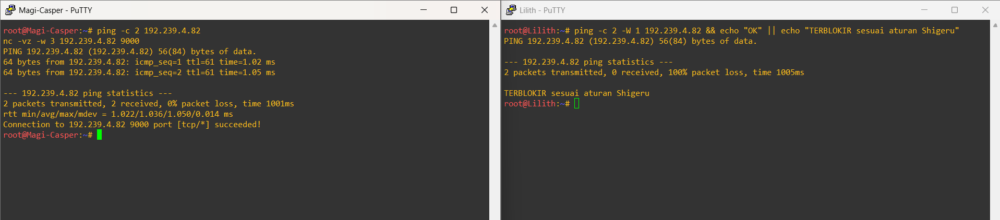

## 5. Kesimpulan

Proses pencadangan dan pemulihan konfigurasi jaringan pada node `Shigeru`, `Fuyutsuki`, dan `Zeruel` terbukti bersifat **idempoten** dan konsisten. Eksekusi `iptables-restore` dan `/root/<nama>.sh` sebanyak dua kali berturut-turut menghasilkan jumlah baris aturan firewall (`filter` & `nat`) serta tabel routing yang sama persis tanpa duplikasi, sekaligus mengembalikan seluruh fungsi konektivitas, DNAT, dan keamanan jaringan seperti semula.

## 6. Pemulihan setelah restart

Apabila proyek atau node mengalami *restart*, seluruh konfigurasi aturan `iptables` dan rute statis dapat dipulihkan secara cepat dengan menjalankan perintah berikut pada masing-masing node:

```sh
# Pada Shigeru
iptables-restore < /root/shigeru.rules && sh /root/shigeru.sh

# Pada Fuyutsuki
iptables-restore < /root/fuyutsuki.rules && sh /root/fuyutsuki.sh

# Pada Zeruel
iptables-restore < /root/zeruel.rules && sh /root/zeruel.sh
```